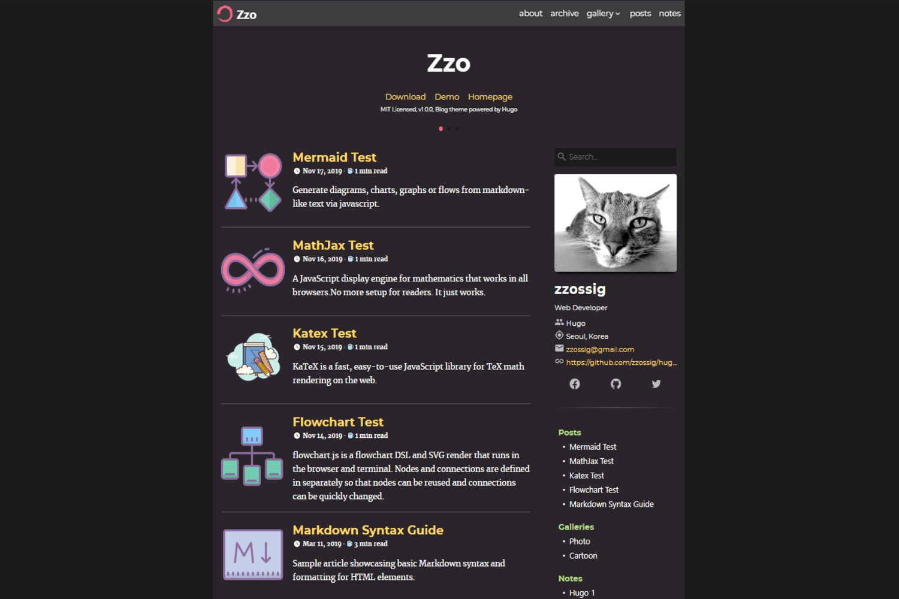

> **本分支要求 Hugo 0.168.0 和 Dart Sass 1.105.2。** 构建步骤及升级说明见[迁移指南](docs/hugo-upgrade.md)。如与上游文档有差异，以迁移指南为准。

[English](README.md) | 简体中文

## Hugo Theme Zzo

Zzo 是一款 Hugo 博客主题，支持搜索、图库、多语言和多套配色，可用于个人博客及作品展示。

## 📄 文档

- [构建与迁移指南](docs/hugo-upgrade.md)
- [上游功能文档](https://zzo-docs.vercel.app/zzo)
- [示例站配置](exampleSite/config/_default)

## ❤️ 支持原作者

如果这个主题对你有帮助，可以[支持原作者 zzossig](https://www.buymeacoffee.com/zzossig)。

## 💡 功能

- 多套配色：深色、浅色、Solarized 等
- 移动端菜单与响应式布局
- 站内搜索、搜索引擎优化（SEO）和 RSS
- 多语言与可配置界面
- 图库与代码高亮
- 演讲、作品展示、出版物、简历和演示页面

## 构建要求

使用 Hugo **0.168.0** 和 Dart Sass **1.105.2**。`scripts/install-tools.sh` 可安装固定版本，支持 macOS arm64 和 Linux x86_64。

```sh
scripts/install-tools.sh
export PATH="$PWD/.build/toolchain:$PWD/.build/toolchain/dart-sass:$PATH"
scripts/build-example.sh
```

站点生成不依赖 Node.js；运行浏览器测试时需要 Node.js。完整测试步骤见[迁移指南](docs/hugo-upgrade.md#build-and-test)。

## 截图


